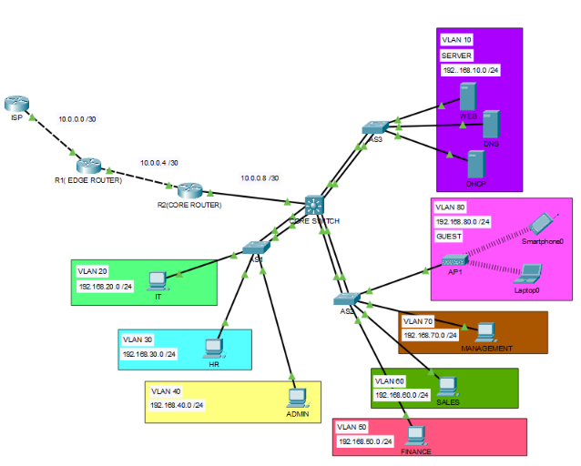

# Network Topology

## 1. Objective
Document the physical and logical layout of the enterprise network, including WAN connectivity, core network, VLAN segmentation, access switches, EtherChannel connections, and internal server network.

## 2. Network Overview

The enterprise network is organized into four main sections:

- **Edge/WAN Network:** Connects the enterprise network to the simulated ISP through R1 (Edge Router).
- **Core Network:** Consists of R2 (Core Router) and the Core Layer 3 Switch, providing routing and connectivity between network segments.
- **Department Access Network:** Consists of three access switches (SW1, SW2, and SW3), connecting departmental end devices through assigned VLANs.
- **Server Network:** Connects internal WEB, DNS, and DHCP servers through SW3 in VLAN 10.

The network uses VLAN segmentation to separate departments and improve network organization, security, and traffic management. LACP EtherChannel links provide aggregated connectivity between the Core Layer 3 Switch and the access switches.

## 3. Device Roles

| Device | Role |
|---|---|
| ISP Router | Simulates the external Internet Service Provider. |
| R1 – Edge Router | Connects the enterprise network to the ISP and performs configured edge routing functions. |
| R2 – Core Router | Connects the edge router to the Core Layer 3 Switch through a routed link. |
| Core Layer 3 Switch | Provides Layer 3 switching, VLAN gateway functions, and inter-VLAN routing. |
| SW1 – Access Switch 1 | Connects IT, HR, and ADMIN departmental devices. |
| SW2 – Access Switch 2 | Connects FINANCE, SALES, MANAGEMENT, and the wireless access point. |
| SW3 – Access Switch 3 | Connects internal WEB, DNS, and DHCP servers. |
| Servers | Provide internal web hosting, DNS resolution, and DHCP address allocation. |
| Wireless Access Point | Provides wireless connectivity for the Guest VLAN. |

## 4. VLAN and IP Addressing Scheme

The enterprise network is divided into eight VLANs. Each VLAN has a dedicated /24 network and gateway address.

| VLAN | Department | Network | Default Gateway |
|---|---|---|---|
| 10 | SERVER | 192.168.10.0/24 | 192.168.10.1 |
| 20 | IT | 192.168.20.0/24 | 192.168.20.1 |
| 30 | HR | 192.168.30.0/24 | 192.168.30.1 |
| 40 | ADMIN | 192.168.40.0/24 | 192.168.40.1 |
| 50 | FINANCE | 192.168.50.0/24 | 192.168.50.1 |
| 60 | SALES | 192.168.60.0/24 | 192.168.60.1 |
| 70 | MANAGEMENT | 192.168.70.0/24 | 192.168.70.1 |
| 80 | GUEST | 192.168.80.0/24 | 192.168.80.1 |

## 5. WAN and Routed IP Addressing

The following /30 networks are used for point-to-point connections between the ISP router, R1, R2, and the Core Layer 3 Switch.

| Connection | Network | First Device | Second Device |
|---|---|---|---|
| ISP – R1 | 10.0.0.0/30 | R1: 10.0.0.1 | ISP: 10.0.0.2 |
| R1 – R2 | 10.0.0.4/30 | R1: 10.0.0.5 | R2: 10.0.0.6 |
| R2 – Core Switch | 10.0.0.8/30 | R2: 10.0.0.9 | Core: 10.0.0.10 |

## 6. Server IP Addressing

All internal servers are connected to SW3 and assigned to VLAN 10.

| Server | IP Address | Default Gateway |
|---|---|---|
| WEB Server | 192.168.10.10 | 192.168.10.1 |
| DNS Server | 192.168.10.20 | 192.168.10.1 |
| DHCP Server | 192.168.10.30 | 192.168.10.1 |

## 7. Physical Connections

### 7.1 Router and Layer 3 Switch Connections

| No. | Device A | Interface | Device B | Interface | Connection Purpose |
|---|---|---|---|---|---|
| 1 | ISP Router | G0/0 | R1 | G0/0 | ISP connectivity |
| 2 | R1 | G0/1 | R2 | G0/0 | Router-to-router link |
| 3 | R2 | G0/1 | Core L3 Switch | G0/1 | Layer 3 routed link |

### 7.2 Core Switch and Access Switch Connections

The Core Layer 3 Switch connects to three access switches using aggregated EtherChannel links.

| No. | Device A | Interfaces | Device B | Interfaces | Connection Purpose |
|---|---|---|---|---|---|
| 1 | Core L3 Switch | F0/1, F0/2 | SW1 | F0/1, F0/2 | EtherChannel |
| 2 | Core L3 Switch | F0/3, F0/4 | SW2 | F0/3, F0/4 | EtherChannel |
| 3 | Core L3 Switch | F0/5, F0/6 | SW3 | F0/5, F0/6 | EtherChannel |

## 8. EtherChannel Configuration

LACP (Link Aggregation Control Protocol) is used to combine multiple physical links into logical EtherChannel connections.

| EtherChannel | Device A | Device A Interfaces | Device B | Device B Interfaces | Protocol |
|---|---|---|---|---|---|
| Po1 | Core L3 | F0/1, F0/2 | SW1 | F0/1, F0/2 | LACP |
| Po2 | Core L3 | F0/3, F0/4 | SW2 | F0/3, F0/4 | LACP |
| Po3 | Core L3 | F0/5, F0/6 | SW3 | F0/5, F0/6 | LACP |

These EtherChannel connections provide increased link capacity and redundancy between the core and access layers.

## 9. Access Switch Connections

### 9.1 Access Switch 1 (SW1)

SW1 connects the IT, HR, and ADMIN departmental computers.

| No. | Switch | Interface | Connected Device | VLAN |
|---|---|---|---|---|
| 1 | SW1 | F0/3 | IT PC | 20 |
| 2 | SW1 | F0/4 | HR PC | 30 |
| 3 | SW1 | F0/5 | ADMIN PC | 40 |

### 9.2 Access Switch 2 (SW2)

SW2 connects the FINANCE, SALES, and MANAGEMENT computers, along with the wireless access point for the Guest network.

| No. | Switch | Interface | Connected Device | VLAN |
|---|---|---|---|---|
| 1 | SW2 | F0/5 | FINANCE PC | 50 |
| 2 | SW2 | F0/6 | SALES PC | 60 |
| 3 | SW2 | F0/7 | MANAGEMENT PC | 70 |
| 4 | SW2 | F0/8 | Wireless Access Point | 80 |

### 9.3 Access Switch 3 (SW3)

SW3 connects the internal servers, which are assigned to VLAN 10.

| No. | Switch | Interface | Connected Device | VLAN |
|---|---|---|---|---|
| 1 | SW3 | F0/1 | WEB Server | 10 |
| 2 | SW3 | F0/2 | DNS Server | 10 |
| 3 | SW3 | F0/3 | DHCP Server | 10 |

## 10. Logical Network Topology

The logical network follows a hierarchical design:

1. The ISP Router provides the simulated external network connection.
2. R1 acts as the enterprise edge router and connects to R2.
3. R2 connects to the Core Layer 3 Switch through a routed point-to-point link.
4. The Core Layer 3 Switch provides the VLAN gateways and inter-VLAN routing.
5. Three access switches connect departmental devices and internal servers through LACP EtherChannel links.
6. VLANs separate departmental traffic, while VLAN 10 provides connectivity to internal network services.

## 11. Verification

The following commands and checks are used to verify the physical and logical network configuration in Cisco Packet Tracer.

### 11.1 Interface Status Verification

Run the following command on routers and Layer 3 switches:

```bash
show ip interface brief
```

This verifies interface status and assigned IP addresses.

### 11.2 CDP Neighbor Verification

```bash
show cdp neighbors
```

This identifies directly connected Cisco devices and their interfaces.

### 11.3 VLAN Verification

```bash
show vlan brief
```

This verifies VLAN creation and access port assignments.

### 11.4 Trunk Verification

```bash
show interfaces trunk
```

This checks trunk links and the VLANs allowed across them.

### 11.5 EtherChannel Verification

```bash
show etherchannel summary
```

This verifies the status of the LACP EtherChannel groups.

### 11.6 Routing Verification

```bash
show ip route
```

This displays the routing table and verifies available network routes.

### 11.7 Connectivity Testing

Use `ping` between devices in different VLANs and between internal servers to verify connectivity and inter-VLAN routing.

## 12. Screenshots

The following screenshot illustrates the completed enterprise network topology in Cisco Packet Tracer.

**Network Topology Screenshot:**



*Figure 1: Enterprise Network Topology in Cisco Packet Tracer.*

The screenshot shows the ISP connection, edge and core routers, Core Layer 3 Switch, three access switches, EtherChannel links, departmental end devices, wireless access point, and internal servers.

