# VLAN Configuration

## 1. Objective

Implement VLAN segmentation to logically separate departments and server infrastructure within the enterprise network. This configuration improves network organization, security, and traffic management by assigning devices to their respective VLANs.

## 2. VLAN Allocation

| VLAN ID | Department | Network |
|---:|---|---|
| 10 | Server | 192.168.10.0/24 |
| 20 | IT | 192.168.20.0/24 |
| 30 | HR | 192.168.30.0/24 |
| 40 | Admin | 192.168.40.0/24 |
| 50 | Finance | 192.168.50.0/24 |
| 60 | Sales | 192.168.60.0/24 |
| 70 | Management | 192.168.70.0/24 |
| 80 | Guest | 192.168.80.0/24 |

## 3. VLAN Configuration

The following Cisco IOS commands were used to create and name the VLANs on the switches.

```cisco
configure terminal

vlan 10
 name SERVER

vlan 20
 name IT

vlan 30
 name HR

vlan 40
 name ADMIN

vlan 50
 name FINANCE

vlan 60
 name SALES

vlan 70
 name MANAGEMENT

vlan 80
 name GUEST

end
```

## 4. VLAN Creation and Port Assignment

VLANs were created on the respective switches, and the required switch ports were assigned to their corresponding VLANs to ensure proper network segmentation.

### 4.1 Switch AS1

**VLAN Creation, Port Assignment, and Interface Configuration**

The screenshots below show the VLAN creation and verification process, port assignments, and interface configuration performed on Switch AS1.

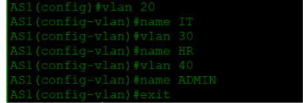

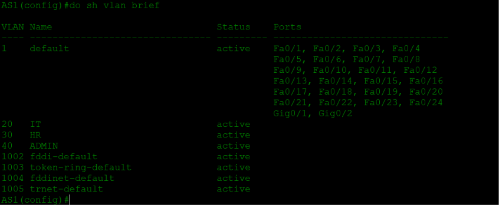

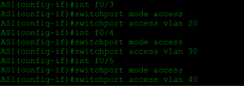

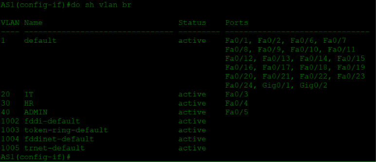

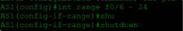

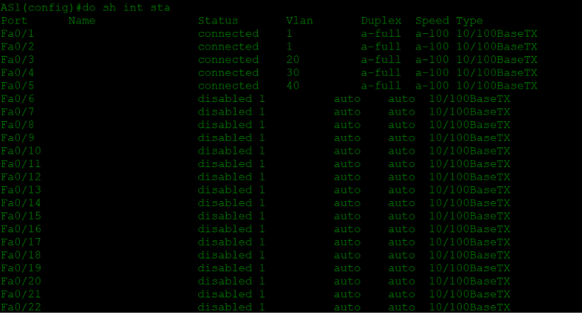

### 4.2 Switch AS2

**VLAN Creation and Port Assignment**

The screenshots below demonstrate the creation of VLANs, assignment of switch ports to their respective VLANs, and verification of the configurations on Switch AS2.

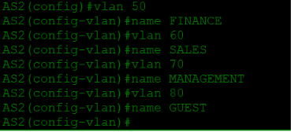

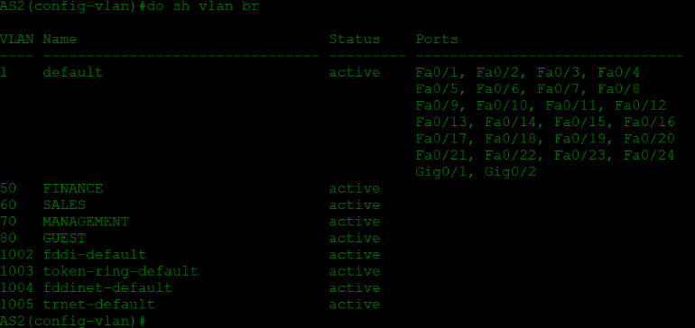

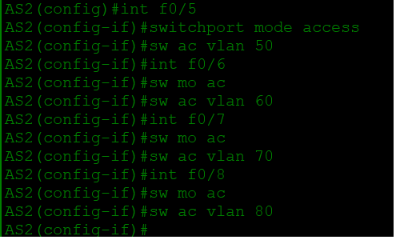

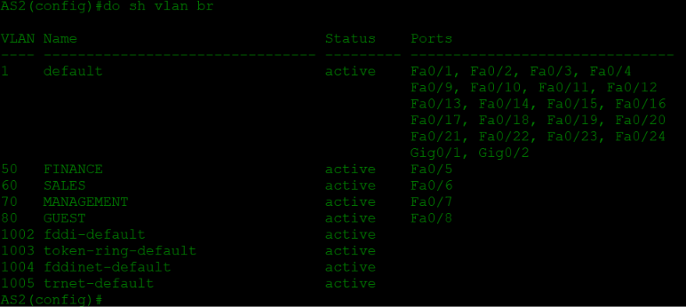

### 4.3 Switch AS3

**VLAN Creation and Verification**

The screenshots below show the VLAN creation process and verification of the configured VLANs on Switch AS3.

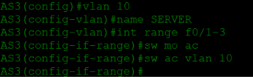

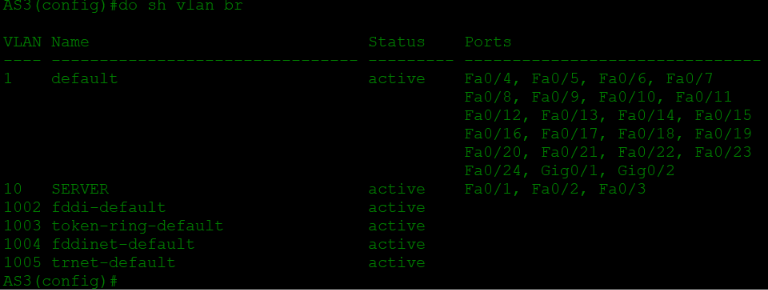

## 5. Verification

The following commands were used to verify the VLAN configuration and trunk connections across the switches.

**Display VLAN Information**

```cisco
show vlan brief
```

This command displays all configured VLANs, their names, statuses, and assigned access ports.

**Verify Trunk Interfaces**

```cisco
show interfaces trunk
```

This command displays trunk interfaces and the VLANs allowed across trunk connections.

**Check Interface Status**

```cisco
show interfaces status
```

This command displays the operational status and VLAN assignment of switch interfaces.

## 6. Conclusion

VLAN segmentation was implemented across switches AS1, AS2, and AS3 to logically separate the different departments and server infrastructure. VLANs were created, named, and assigned to the appropriate switch ports. Verification commands were also used to check the VLAN configurations, trunk connections, and interface statuses.
