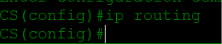
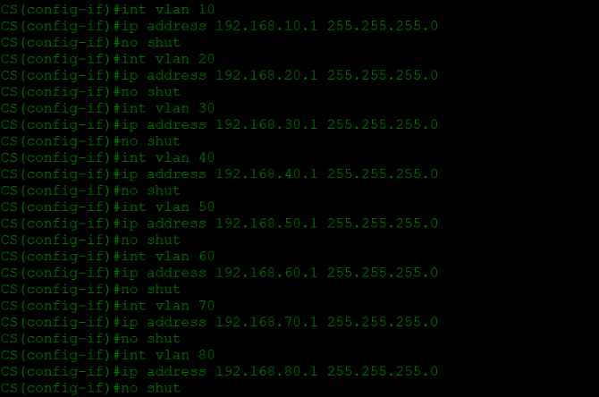
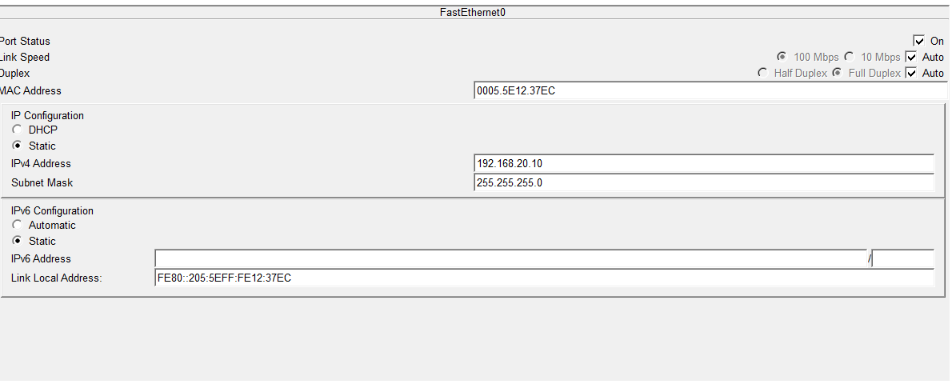
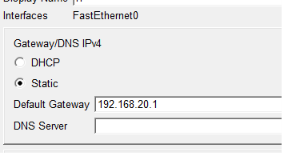
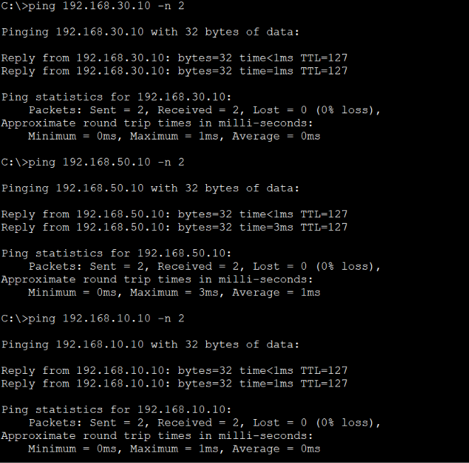
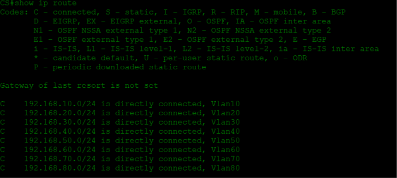

# Inter-VLAN Routing

## 1. Objective
Allow authorized communication between different VLANs using Layer 3 routing.

Inter-VLAN routing enables devices connected to different VLANs to communicate with each other through a Layer 3 switch. This allows communication between separate network segments while maintaining VLAN separation.

## 2. Implementation
Inter-VLAN routing is provided by the Layer 3 switch using Switched Virtual Interfaces (SVIs).

The Layer 3 switch performs routing between VLANs. The `ip routing` command enables Layer 3 routing functionality.

The implementation involves:
- Enabling IP routing on the Layer 3 switch.
- Configuring SVIs for the required VLANs.
- Assigning IP addresses to the VLAN interfaces.
- Configuring the appropriate default gateways on end devices.
- Verifying connectivity between different VLANs.
- Checking the routing table to confirm routing information.

## 3. Configuration

### 3.1 Enable IP Routing

Enable Layer 3 routing on the switch using the following Cisco commands:

```cisco
configure terminal
ip routing
end
```



### 3.2 Configure VLAN Interfaces (SVIs)

Configure an SVI for each VLAN that requires a gateway.

Example configuration:

```cisco
configure terminal
interface vlan 20
 ip address [GATEWAY-IP] 255.255.255.0
 no shutdown
end
```

Repeat the configuration for each VLAN using its appropriate gateway IP address and subnet mask.



### 3.3 Configure IP Addressing on End Devices

Configure the IP address, subnet mask, and default gateway on the end devices according to their respective VLANs.

The default gateway must correspond to the IP address configured on the SVI for that VLAN.






## 4. Verification

After completing the configuration, use the following Cisco IOS commands to verify the Layer 3 switch configuration.

### 4.1 Verify Interface Status

```cisco
show ip interface brief
```

This command displays the IP addresses and operational status of the switch interfaces and VLAN interfaces.

### 4.2 Verify Routing Table

```cisco
show ip route
```

This command displays the routing table and allows verification of the connected networks and available routes.

### 4.3 Verify VLAN Configuration

```cisco
show vlan brief
```

This command displays the VLANs configured on the switch.

### 4.4 Verify Inter-VLAN Connectivity

Use the ping command from one device to another device located in a different VLAN.

```cisco
ping [DESTINATION-IP]
```

A successful ping indicates that communication between the tested devices is working.



### 4.5 Verify Routing Table Configuration

Check the routing table on the Layer 3 switch to verify the available network routes.

```cisco
show ip route
```



## 5. Testing Results

The following configuration and verification activities were performed:

1. Enabled Layer 3 routing using the `ip routing` command.
2. Configured VLAN interfaces using SVIs.
3. Assigned IP addresses to the VLAN interfaces.
4. Configured IP addressing on the end devices.
5. Verified IP address assignments.
6. Performed inter-VLAN connectivity testing.
7. Checked the routing table using `show ip route`.
8. Verified the VLAN configuration using `show vlan brief`.

The screenshots provide visual evidence of the IP routing configuration, IP assignment, inter-VLAN verification, and routing table inspection.

Specific successful or unsuccessful ping results and ACL restrictions are not documented because their exact outcomes cannot be confirmed from the available screenshots.

## 6. Screenshots

The following screenshots document the Inter-VLAN Routing implementation and verification:

### 6.1 Enable Routing


### 6.2 IP Assignment Configuration


### 6.3 Verify IP Assignment


### 6.4 Static IP Configuration


### 6.5 Verify Inter-VLAN Connectivity


### 6.6 Routing Table Verification


