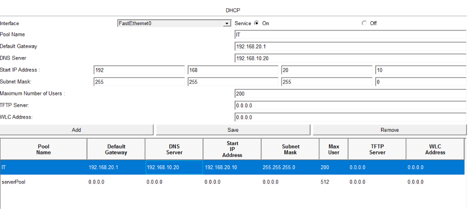
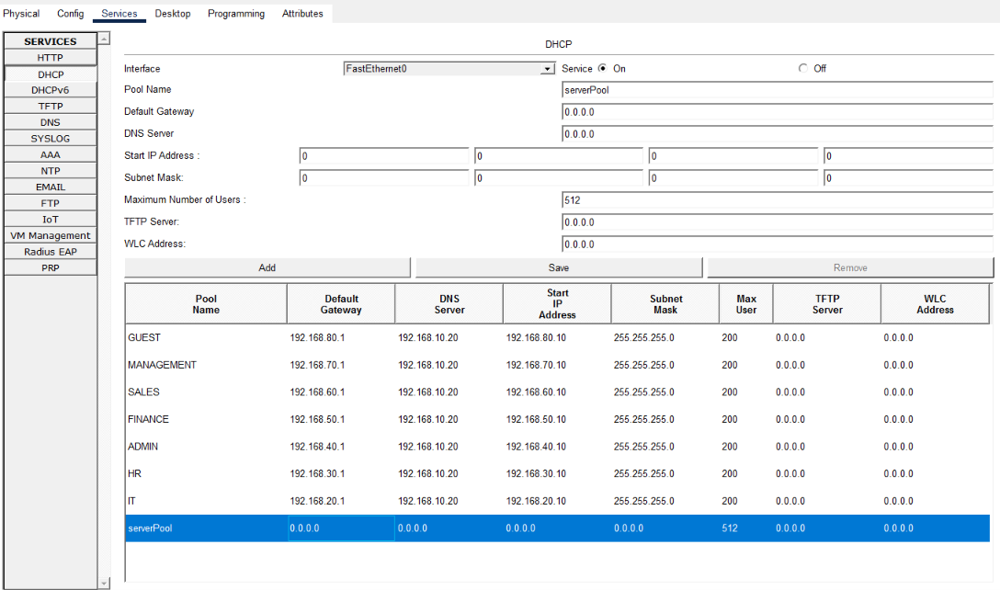
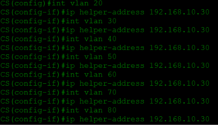
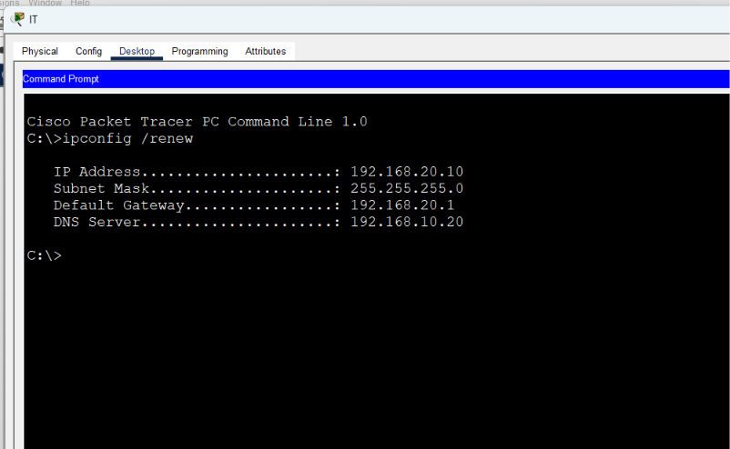
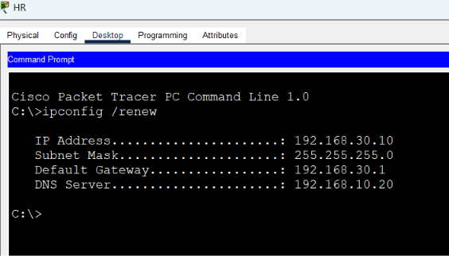
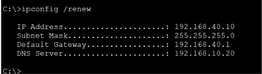
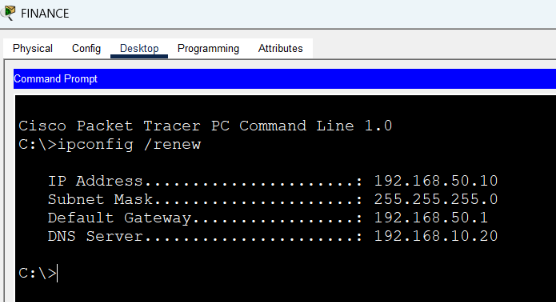
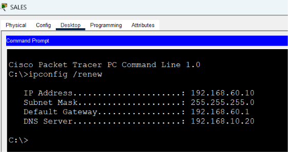
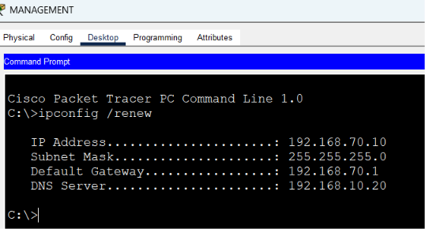
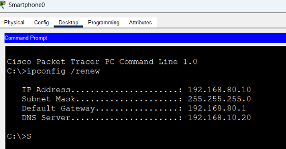

# DHCP Configuration

## 1. Objective

Automatically assign IPv4 configuration to client devices using DHCP services.

## 2. Implementation

The DHCP server is configured to automatically distribute IP addresses and network settings to clients across multiple VLANs. DHCP pools are configured for the required departments, and DHCP relay is used where necessary to forward client requests to the DHCP server.

## 3. DHCP Scope Information

The DHCP pools are configured for the different VLANs and departments. Each pool provides the appropriate IP address range and network configuration to its clients.

| VLAN | Network | Default Gateway | DNS Server | Address Pool |
|---|---|---|---|---|
| Department VLANs | As configured | As configured | As configured | As configured |

## 4. Configuration

The DHCP pools are configured under **Services > DHCP** on the Packet Tracer server.

The following screenshots show the DHCP pool configuration and DHCP relay settings:

### DHCP Pool Configuration

### DHCP Pool Details

### DHCP Helper Configuration

## 5. Verification

DHCP configuration was verified by checking whether client devices from different departments successfully received IP addresses from the DHCP server.

### IT Department

### HR Department

### Administration Department

### Finance Department

### Sales Department

### Management Department

### Guest Department

### DHCP Server IP Verification

## 6. Testing Results

DHCP verification was performed across the different department VLANs. The client verification screenshots document the DHCP testing process, while the server IP verification screenshot documents the DHCP server configuration.

The testing focused on:

- Automatic IPv4 address assignment.
- DHCP pool configuration for different departments.
- DHCP helper configuration.
- DHCP server IP verification.
- Successful DHCP configuration across client VLANs.

## 7. Screenshots

The following screenshots are included as evidence of DHCP implementation and testing:

1. `/Screenshots/it-dhcp-pool.png`
2. `/Screenshots/dhcp-pool-config.png`
3. `/Screenshots/dhcp-helper-cs.png`
4. `/Screenshots/verify-dhcp-it.png`
5. `/Screenshots/verify-dhcp-hr.png`
6. `/Screenshots/verify-dhcp-admin.png`
7. `/Screenshots/verify-dhcp-finance.png`
8. `/Screenshots/verify-dhcp-sales.png`
9. `/Screenshots/verify-dhcp-management.png`
10. `/Screenshots/verify-dhcp-guest.png`
11. `/Screenshots/verify-dhcp-server-ip.png`
