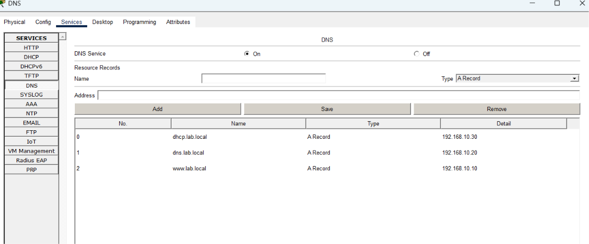
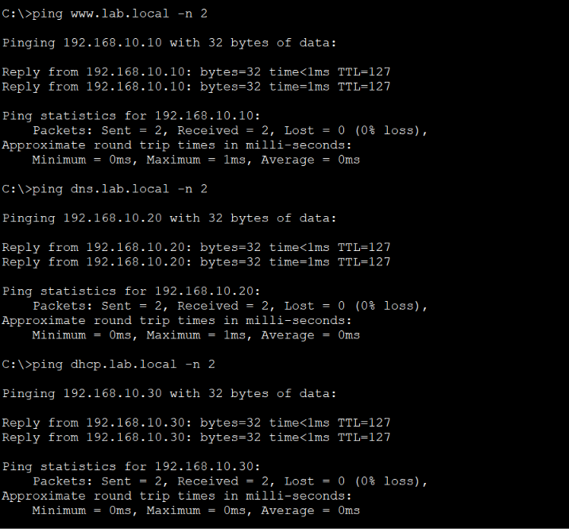

# DNS and Server Services

## 1. Objective

Document the DNS service configured in the enterprise network and demonstrate how clients use DNS to resolve hostnames into IP addresses.

## 2. Server Inventory

The following table identifies the server services documented in the network.

| Service | Server Name | IP Address |
|---|---|---|
| DNS | DNS Server | 192.168.10.20 |

## 3. DNS Configuration

The DNS service is configured on the Packet Tracer server under **Services > DNS**.

The DNS server is configured to provide hostname resolution for client devices across the enterprise network.

### DNS Server Configuration

### DNS Host Records

The DNS service contains the hostname records configured for the enterprise network.

| Hostname | Record Type | IP Address |
|---|---|---|
| google.com | A | 8.8.8.8 |

## 4. Other Server Services

This section focuses on the DNS service configured in the network. No additional server services are documented in the provided screenshots.

## 5. Verification

DNS configuration was verified by checking the DNS server settings and testing DNS functionality.

The following screenshot demonstrates the DNS server verification.

### DNS Server Verification

## 6. Testing Results

DNS server configuration and verification were performed to ensure that the DNS service was configured in the enterprise network.

The verification screenshot provides evidence of the DNS server testing process.

## 7. Screenshots

The following screenshots are included as evidence of DNS configuration and verification:

1. `/Screenshots/set-dns-server.png`
2. `/Screenshots/verify-dns-server.png`
