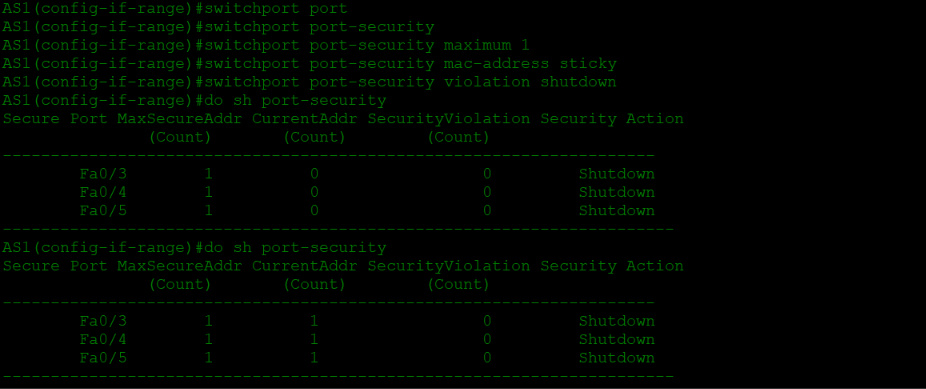
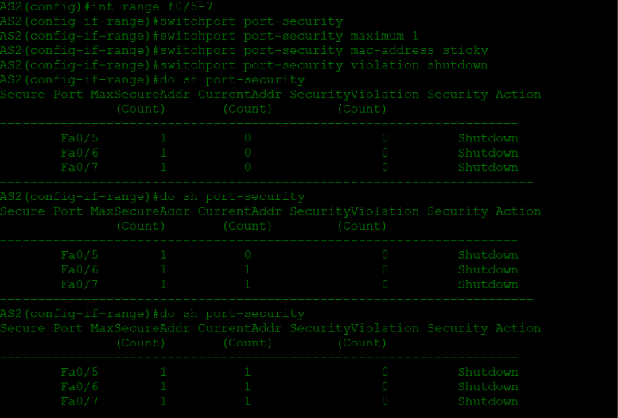
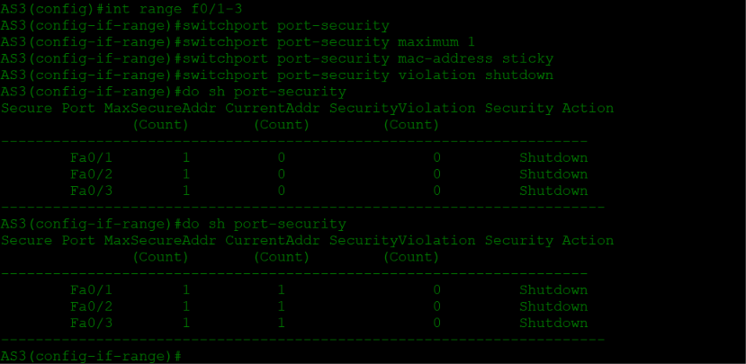
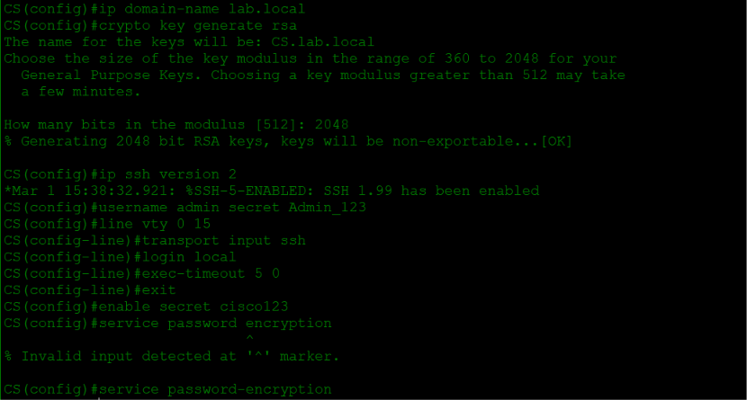
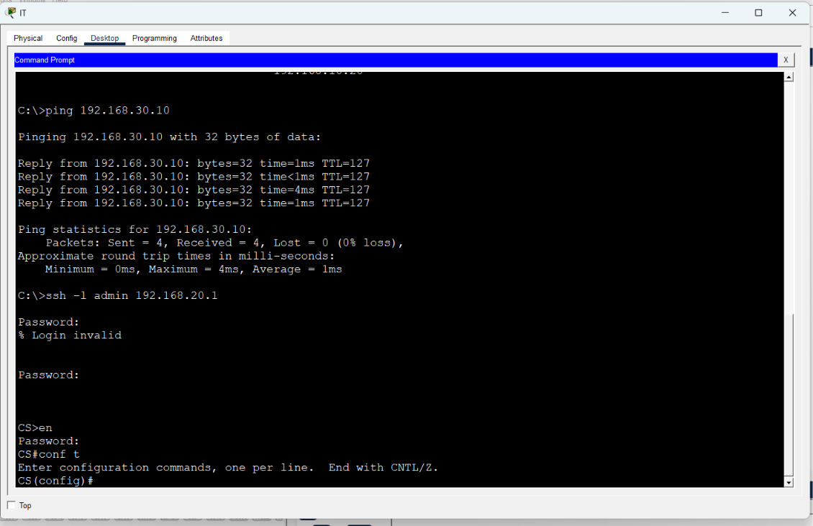
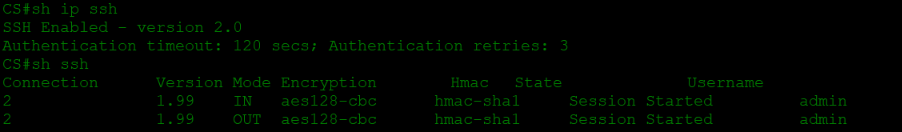

## Port Security and SSH

## 1. Objective

The objective of this lab is to configure basic switch-port security and secure remote management using SSH. Port security helps prevent unauthorized devices from connecting to the network, while SSH provides secure remote access to network devices.

## 2. Port Security

Port security was configured on the required switch access ports to control which devices can connect to the network.

The configuration includes:
- Restricting access ports using port security.
- Setting the maximum number of allowed MAC addresses.
- Configuring the violation action.
- Enabling sticky MAC learning where configured.

The following screenshots show the port-security configuration:







## 3. SSH Configuration

SSH was configured to provide secure remote management of network devices.

The configuration includes:
- Enabling SSH on the required devices.
- Assigning management IP addresses.
- Configuring SSH version 2.
- Setting up local authentication.
- Verifying SSH connectivity.

The following screenshots show the SSH configuration and verification:







## 4. Configuration

The following commands were used for port security and SSH configuration.

### Port Security Commands

```cisco
interface [INTERFACE]
switchport mode access
switchport port-security
switchport port-security maximum [NUMBER]
switchport port-security violation [ACTION]
switchport port-security mac-address sticky
```

### SSH Configuration Commands

```cisco
hostname [DEVICE_NAME]
ip domain-name [DOMAIN]
crypto key generate rsa
ip ssh version 2
username [USERNAME] secret [PASSWORD]
line vty 0 15
login local
transport input ssh
```

### Verification Commands

```cisco
show port-security
show port-security interface [INTERFACE]
show ip ssh
show running-config
```

## 5. Testing Results

Port security was configured to restrict unauthorized devices from accessing protected switch ports. SSH management access was tested to verify that remote connections could be established securely.

## 6. Screenshots

### Port Security

- `/Screenshots/port-security-as1.png`
- `/Screenshots/port-security-as2.png`
- `/Screenshots/port-security-as3.png`

### SSH Configuration and Verification

- `/Screenshots/ssh-cs.png`
- `/Screenshots/verify-ssh-cs.png`
- `/Screenshots/show-ssh-cs.png`

**Note:** Passwords and private keys are not included in this documentation.
