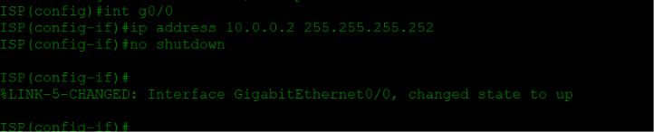
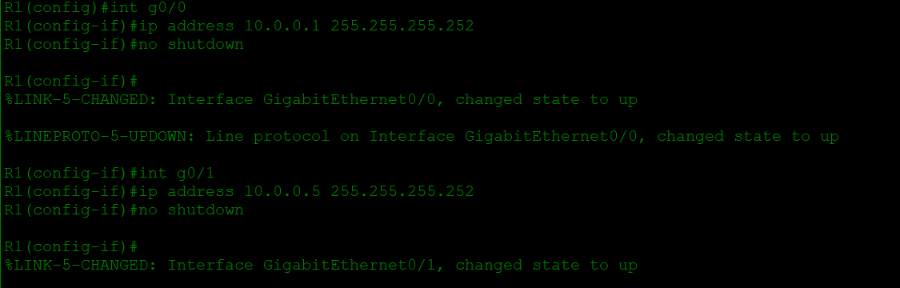
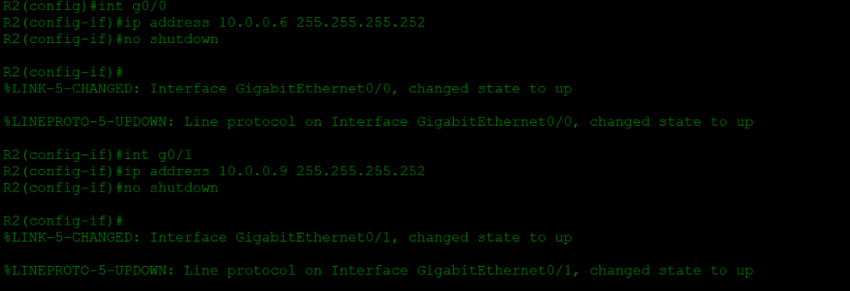
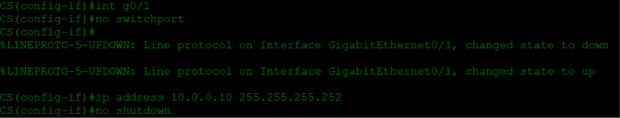
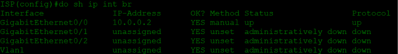
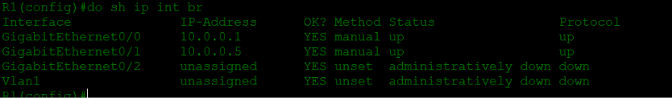
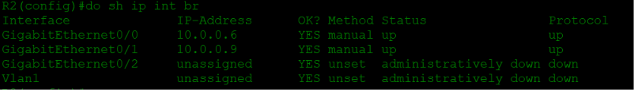
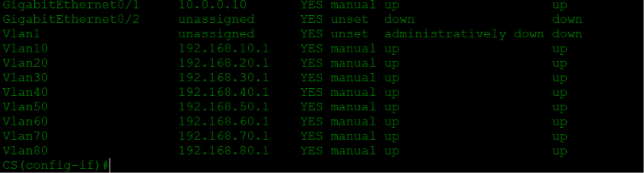
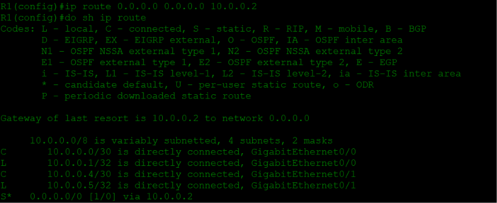

## IP Address Configuration

The IP addressing configuration was implemented according to the provided network addressing table. Static IP addresses were assigned to the ISP router, R1, R2, and the Core Switch to establish communication between the network devices.

### 1. Configure IP Address on ISP Router

The ISP router was configured with the IP address `10.0.0.2/30` on its connection to R1. This address belongs to the `10.0.0.0/30` network.

**Configuration commands:**

```bash
enable
configure terminal
interface <ISP-to-R1-interface>
ip address 10.0.0.2 255.255.255.252
no shutdown
exit
```

**Screenshot:**



### 2. Configure IP Addresses on R1

R1 connects the ISP router to R2. Two IP addresses were assigned according to the network addressing table:

- ISP connection: `10.0.0.1/30`
- R2 connection: `10.0.0.5/30`

**Configuration commands:**

```bash
enable
configure terminal

interface <ISP-facing-interface>
ip address 10.0.0.1 255.255.255.252
no shutdown
exit

interface <R2-facing-interface>
ip address 10.0.0.5 255.255.255.252
no shutdown
exit
```

**Screenshot:**



### 3. Configure IP Addresses on R2

R2 connects R1 to the Core Switch. The following IP addresses were assigned:

- R1 connection: `10.0.0.6/30`
- Core Switch connection: `10.0.0.9/30`

**Configuration commands:**

```bash
enable
configure terminal

interface <R1-facing-interface>
ip address 10.0.0.6 255.255.255.252
no shutdown
exit

interface <Core-Switch-facing-interface>
ip address 10.0.0.9 255.255.255.252
no shutdown
exit
```

**Screenshot:**



### 4. Configure IP Address on Core Switch

The Core Switch was assigned the IP address `10.0.0.10/30` on its connection to R2. This allows the Core Switch to communicate with R2 through the `10.0.0.8/30` network.

**Configuration commands:**

```bash
enable
configure terminal
interface <R2-facing-interface>
no switchport
ip address 10.0.0.10 255.255.255.252
no shutdown
exit
```

**Screenshot:**



## IP Address Verification

After configuring the IP addresses, the configurations were checked to ensure that the assigned addresses were correctly applied to the network interfaces.

### 5. Verify IP Address on ISP Router

The `show ip interface brief` command can be used to display the interfaces, their assigned IP addresses, and their operational status.

**Verification command:**

```bash
show ip interface brief
```

**Screenshot:**



### 6. Verify IP Addresses on R1

The interface configuration on R1 was checked to confirm that the ISP-facing and R2-facing interfaces had the correct IP addresses.

**Verification commands:**

```bash
show ip interface brief
show running-config
```

**Screenshot:**



### 7. Verify IP Addresses on R2

The IP addressing configuration on R2 was checked to confirm that both connections were assigned the correct addresses.

**Verification commands:**

```bash
show ip interface brief
show running-config
```

**Screenshot:**



### 8. Verify IP Address on Core Switch

The Core Switch interface configuration was checked to ensure that the connection to R2 had the correct IP address.

**Verification commands:**

```bash
show ip interface brief
show running-config
```

**Screenshot:**



## Default Route Configuration

### 9. Configure Default Route

A default route provides a path for forwarding packets when the destination network is not available in the router's routing table.

For the connection between R1 and the ISP, the ISP router's IP address (`10.0.0.2`) is the next-hop address.

**Configuration commands on R1:**

```bash
enable
configure terminal
ip route 0.0.0.0 0.0.0.0 10.0.0.2
exit
```

This configuration directs traffic for destinations that are not found in R1's routing table toward the ISP router.

**Verification commands:**

```bash
show ip route
show running-config
```

**Screenshot:**


