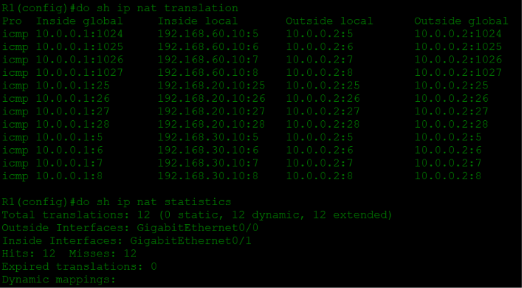

# NAT and PAT

## 1. Objective
The objective of this lab is to document the address translation used to allow internal devices to communicate with the simulated external network. The internal networks use private 192.168.x.0/24 addresses, which cannot be routed on an external network. NAT/PAT translates these private source addresses into the address of the router's outside interface, so internal hosts can reach external resources and many hosts can share a single outside address.

## 2. Implementation
Address translation is performed on R1, the router connected to the simulated ISP. According to the IP addressing plan, the ISP - R1 link uses the network 10.0.0.0/30, where R1 is 10.0.0.1 and the ISP is 10.0.0.2.

- **Inside interface:** The R1 interface facing the internal network (towards R2), on the 10.0.0.4/30 link (R1: 10.0.0.5).
- **Outside interface:** The R1 interface facing the ISP, on the 10.0.0.0/30 link (R1: 10.0.0.1).

PAT (NAT overload) was used. Internal traffic leaves R1 through the outside interface and is translated to the outside interface address, with a different port number keeping each session unique.

### Network Reference
| Connection | Network | First device | Second device |
|---|---|---|---|
| ISP - R1 | 10.0.0.0/30 | R1: 10.0.0.1 | ISP: 10.0.0.2 |
| R1 - R2 | 10.0.0.4/30 | R1: 10.0.0.5 | R2: 10.0.0.6 |
| R2 - Core Switch | 10.0.0.8/30 | R2: 10.0.0.9 | Core: 10.0.0.10 |

## 3. NAT Details
| Item | Value |
|---|---|
| NAT device | R1 |
| Inside interface | R1 interface facing R2 (10.0.0.5/30) |
| Outside interface | R1 interface facing the ISP (10.0.0.1/30) |
| Inside address range | Internal private networks 192.168.10.0/24 to 192.168.80.0/24 (VLANs 10 to 80) |
| Translation method | PAT (NAT overload) |

## 4. Configuration
The NAT configuration on R1 has three parts, shown in the screenshot below:

1. A standard access list that identifies the private networks allowed to be translated.
2. The `ip nat inside source list ... interface ... overload` command, which links the access list to the outside interface and enables PAT.
3. The `ip nat inside` and `ip nat outside` commands, which mark the interface facing the internal network and the interface facing the ISP.


### Explanation
- **Access list:** Defines which internal networks are allowed to use NAT. Traffic from networks not listed is not translated.
- **`ip nat inside source list ... overload`:** Enables PAT, so many internal hosts can share the single outside interface address by using different port numbers.
- **`ip nat inside` / `ip nat outside`:** Tell the router which interface faces the internal network and which faces the external network. Both are required, because translation only happens for traffic moving between an inside and an outside interface.

## 5. Verification
The following commands were used to verify the NAT/PAT operation on R1:

```cisco
show ip nat translations
show ip nat statistics
```

- `show ip nat translations` displays the active translation entries, mapping inside local addresses (private) to inside global addresses (translated).
- `show ip nat statistics` shows the inside and outside interfaces, the number of active translations, and the number of NAT hits and misses.

Access to the simulated external server was also tested from an internal client.



## 6. Testing Results
Internal clients were tested against the simulated external server to confirm that traffic leaving the internal network is translated correctly. The translation table on R1 was then checked to confirm that NAT entries were created for this traffic. The output of these checks is shown in the verification screenshot.

| Test | Purpose | Verification Method |
|---|---|---|
| Access the simulated external server from an internal client | Confirm internal hosts can reach the external network through PAT | Connectivity test, see `verify-nat-overload` |
| Check the NAT translation table on R1 | Confirm translations were created for internal traffic | `show ip nat translations`, see `verify-nat-overload` |
| Check NAT statistics on R1 | Confirm NAT interfaces and translation counters | `show ip nat statistics`, see `verify-nat-overload` |

### Explanation
Because internal hosts use private addresses, they can only reach the external network if R1 translates their source addresses. Translation entries in the table, together with successful access to the external server, confirm that PAT is working. The entries show each private source address and port mapped to the outside interface address of R1.

## 7. Screenshots

### NAT Configuration


### Translation Table and Connectivity

