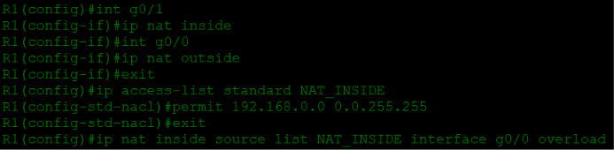

# NAT and PAT

## 1. Objective
The objective of this lab is to document the address translation used to allow internal devices (private 192.168.x.x networks) to communicate with the simulated external network. NAT/PAT replaces the private source addresses of outgoing traffic with a public-facing address, so internal hosts can reach external resources without their private addresses being exposed.

## 2. Implementation
The NAT/PAT configuration is performed on the edge router connecting the internal network to the simulated ISP. According to the IP addressing plan, the link between R1 and the ISP uses the network 10.0.0.0/30, where R1 is 10.0.0.1 and the ISP is 10.0.0.2.

- **Inside interface:** The interface facing the internal network (towards R2 and the rest of the campus).
- **Outside interface:** The interface facing the ISP (10.0.0.1/30).

*(TODO: Confirm that R1 is the device performing NAT/PAT and fill in the exact interface names from your `nat-overload` screenshot.)*

### Network Reference
| Connection | Network | First device | Second device |
|---|---|---|---|
| ISP - R1 | 10.0.0.0/30 | R1: 10.0.0.1 | ISP: 10.0.0.2 |
| R1 - R2 | 10.0.0.4/30 | R1: 10.0.0.5 | R2: 10.0.0.6 |
| R2 - Core Switch | 10.0.0.8/30 | R2: 10.0.0.9 | Core: 10.0.0.10 |

## 3. NAT Details
| Item | Value |
|---|---|
| NAT device | [Device name, e.g. R1] |
| Inside interface | [Interface facing R2, see nat-overload] |
| Outside interface | [Interface facing ISP, see nat-overload] |
| Inside address range | [Private network(s) from nat-overload, e.g. 192.168.x.0/24 networks] |
| Translation method | [PAT (overload) if confirmed by the ip nat inside source command] |

## 4. Configuration
The commands below define which private networks may be translated, translate them using the outside interface address (PAT), and mark the inside and outside interfaces.

```cisco
! Insert the actual NAT commands used (see nat-overload screenshot)
! access-list [NUMBER] permit [INSIDE-NETWORK] [WILDCARD-MASK]
! ip nat inside source list [NUMBER] interface [OUTSIDE-INTERFACE] overload
!
! interface [INSIDE-INTERFACE]
!  ip nat inside
!
! interface [OUTSIDE-INTERFACE]
!  ip nat outside
```



### Explanation
- **Access list:** Identifies the private networks that are allowed to be translated.
- **`ip nat inside source list ... overload`:** Enables PAT, allowing many internal hosts to share a single outside address by using different port numbers.
- **`ip nat inside` / `ip nat outside`:** Tell the router which interface faces the internal network and which faces the external network.

## 5. Verification
The following commands were used to confirm that translations are created and that NAT is working.

```cisco
show ip nat translations
show ip nat statistics
```

- `show ip nat translations` displays the active translations between inside local addresses (private) and inside global addresses (translated).
- `show ip nat statistics` shows the inside and outside interfaces, the number of active translations and the number of hits and misses.

Connectivity to the simulated external server was also tested from an internal client.


## 6. Testing Results
| Test | Source | Destination | Expected Result | Actual Result |
|---|---|---|---|---|
| Access external server | [Internal PC, 192.168.x.x] | [Simulated external server] | Reachable | [Result, see verify-nat-overload] |
| NAT translation created | [Internal PC] | [Simulated external server] | Translation entry appears | [Entry seen in show ip nat translations, see verify-nat-overload] |

### Explanation
- **Connectivity:** [Describe whether the internal client reached the external network.]
- **Translations:** [Describe the entries in the translation table, e.g. which inside local addresses were translated to which inside global address.]

## 7. Screenshots

### NAT Configuration


### Translation Table and Connectivity

