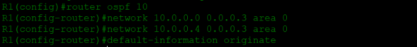
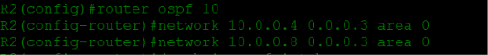
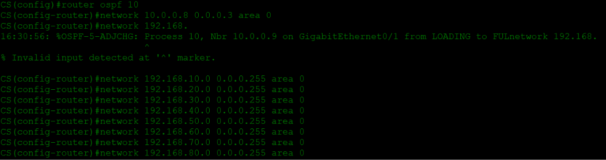
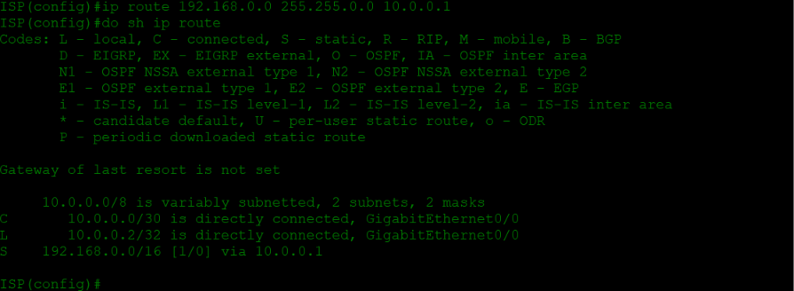
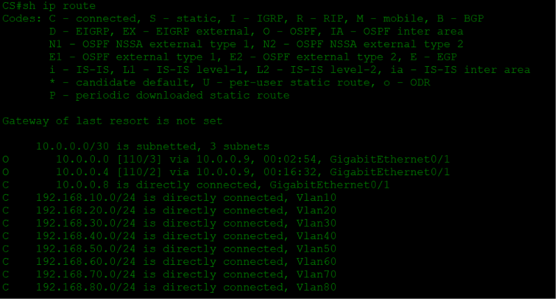
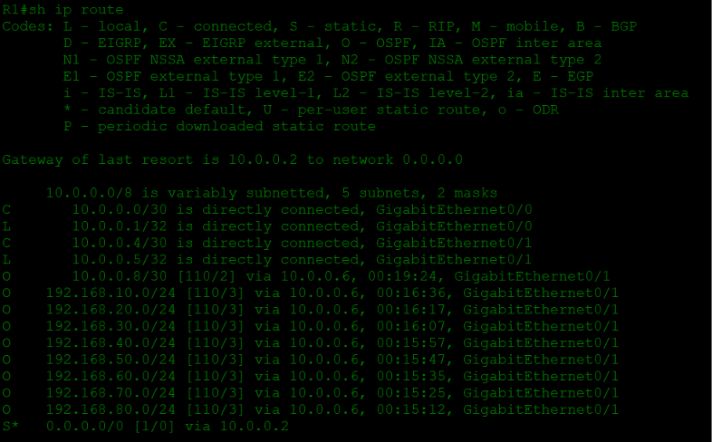
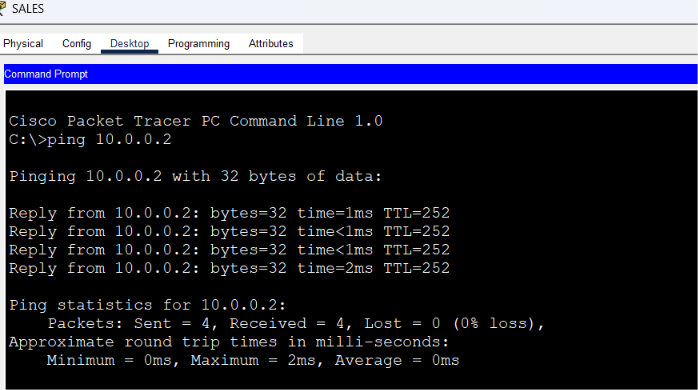
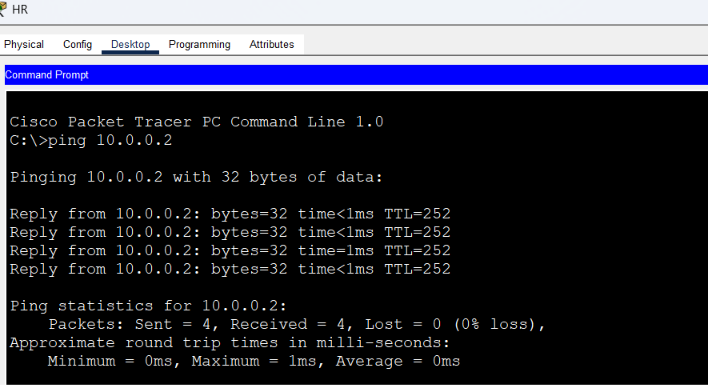
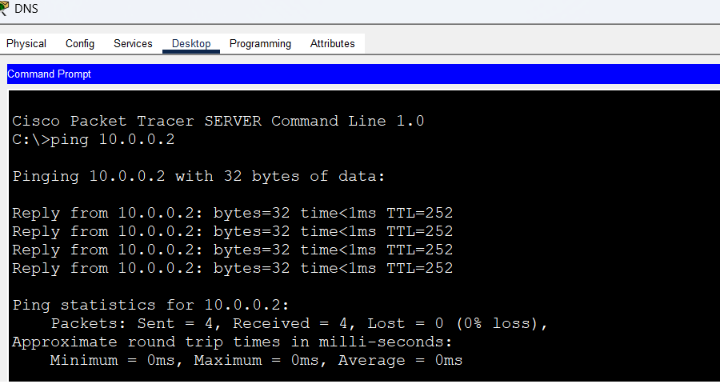

# OSPF Configuration

## 1. Objective

The objective of this task is to implement Open Shortest Path First (OSPF) routing to dynamically exchange routing information between participating Layer 3 devices.

OSPF allows routers and the Layer 3 Core Switch to learn remote networks automatically without requiring static routes for every destination.

In this topology, OSPF is used between R1, R2, and the Core Switch to provide connectivity between different network segments and VLANs.

The main objectives are:
- Configure OSPF on the participating devices.
- Advertise connected networks through OSPF.
- Establish OSPF neighbor relationships.
- Verify that OSPF routes are learned dynamically.
- Test connectivity between remote devices using ping.

## 2. Implementation

OSPF is implemented on three main network devices:

- **R1:** Connects to the ISP and R2.
- **R2:** Connects R1 to the Layer 3 Core Switch.
- **Core Switch:** Provides connectivity to the internal VLANs.

The IP addressing plan for the network connections is:

| Connection | Network | First Device | Second Device |
|---|---|---|---|
| ISP – R1 | 10.0.0.0/30 | R1: 10.0.0.1 | ISP: 10.0.0.2 |
| R1 – R2 | 10.0.0.4/30 | R1: 10.0.0.5 | R2: 10.0.0.6 |
| R2 – Core Switch | 10.0.0.8/30 | R2: 10.0.0.9 | Core: 10.0.0.10 |

The internal VLAN networks connected to the Core Switch are:

| VLAN | Department | Network | Gateway |
|---|---|---|---|
| 10 | SERVER | 192.168.10.0/24 | 192.168.10.1 |
| 20 | IT | 192.168.20.0/24 | 192.168.20.1 |
| 30 | HR | 192.168.30.0/24 | 192.168.30.1 |
| 40 | ADMIN | 192.168.40.0/24 | 192.168.40.1 |
| 50 | FINANCE | 192.168.50.0/24 | 192.168.50.1 |
| 60 | SALES | 192.168.60.0/24 | 192.168.60.1 |
| 70 | MANAGEMENT | 192.168.70.0/24 | 192.168.70.1 |
| 80 | GUEST | 192.168.80.0/24 | 192.168.80.1 |

OSPF dynamically exchanges routing information between participating devices, allowing R1 to reach networks connected through R2 and the Core Switch.

## 3. OSPF Details

The following table identifies the devices participating in OSPF and their advertised networks.

| Device | Process ID | Area | Networks Advertised |
|---|---|---|---|
| R1 | As configured | As configured | 10.0.0.4/30 |
| R2 | As configured | As configured | 10.0.0.4/30, 10.0.0.8/30 |
| Core Switch | As configured | As configured | 10.0.0.8/30 and internal VLAN networks, where configured |

The OSPF process ID and area ID should be confirmed from the actual device configurations.

The internal VLAN networks are advertised through OSPF when configured on the Core Switch.

## 4. Configuration

OSPF configuration is performed on R1, R2, and the Core Switch.

The following commands show the relevant configuration syntax. The process ID and area ID must match the actual lab configuration.

**R1 – OSPF Configuration**

```cisco
enable
configure terminal
router ospf [PROCESS-ID]
network 10.0.0.4 0.0.0.3 area [AREA-ID]
end
show running-config
```

**R2 – OSPF Configuration**

```cisco
enable
configure terminal
router ospf [PROCESS-ID]
network 10.0.0.4 0.0.0.3 area [AREA-ID]
network 10.0.0.8 0.0.0.3 area [AREA-ID]
end
show running-config
```

**Core Switch – OSPF Configuration**

```cisco
enable
configure terminal
router ospf [PROCESS-ID]
network 10.0.0.8 0.0.0.3 area [AREA-ID]
end
show running-config
```

The internal VLAN networks can also be advertised through OSPF if configured on the Core Switch.

The corresponding wildcard masks for the internal VLAN networks are:

| Network | Wildcard Mask |
|---|---|
| 192.168.10.0/24 | 0.0.0.255 |
| 192.168.20.0/24 | 0.0.0.255 |
| 192.168.30.0/24 | 0.0.0.255 |
| 192.168.40.0/24 | 0.0.0.255 |
| 192.168.50.0/24 | 0.0.0.255 |
| 192.168.60.0/24 | 0.0.0.255 |
| 192.168.70.0/24 | 0.0.0.255 |
| 192.168.80.0/24 | 0.0.0.255 |

Example of advertising an internal VLAN network:

```cisco
router ospf [PROCESS-ID]
network 192.168.10.0 0.0.0.255 area [AREA-ID]
```

These commands are configuration examples based on the provided addressing plan. They should not be treated as confirmation of the exact commands applied in the lab.

## 5. Verification

After configuring OSPF, several verification commands are used to check neighbor relationships, routing information, and participating interfaces.

**Check OSPF Neighbors**

```cisco
show ip ospf neighbor
```

This command displays neighboring OSPF routers and their adjacency states. A successful adjacency should reach the FULL state where a full adjacency is expected.

**Check OSPF Protocol Information**

```cisco
show ip protocols
```

This command displays information about the routing protocols running on the device, including OSPF process information and advertised networks.

**Check OSPF Routes**

```cisco
show ip route ospf
```

This command displays routes learned through OSPF. OSPF-learned routes are identified by the letter O in the routing table.

**Check OSPF Interfaces**

```cisco
show ip ospf interface brief
```

This command displays the interfaces participating in OSPF and their associated areas.

**Test Connectivity from R1 to Remote Networks**

To test connectivity from R1 to remote OSPF-connected devices, use:

```cisco
ping [REMOTE-DEVICE-IP]
```

The destination IP should be taken from the actual remote device configuration.

The ping tests help verify whether routing information is correctly exchanged and whether communication is possible between different network segments.

## 6. Testing Results

OSPF verification and connectivity testing were documented using the provided screenshots.

The following tests are included:

1. **OSPF Neighbor Verification:** Checks whether R1, R2, and the Core Switch establish the expected OSPF neighbor relationships.
2. **Routing Table Verification:** Checks whether remote networks appear in the routing table as OSPF-learned routes.
3. **Protocol Verification:** Checks the OSPF process and advertised networks using `show ip protocols`.
4. **Connectivity Testing:** Uses ping commands to test communication between remote devices connected through the OSPF network.

The screenshots include OSPF configuration, routing verification, and ping connectivity tests.

The exact neighbor states and ping success rates should be taken from the original terminal outputs rather than assumed.

## 7. Screenshots

The following screenshots provide evidence of the OSPF configuration, verification, and connectivity testing performed during the lab.

**1. OSPF Configuration on R1**



**2. OSPF Configuration on R2**



**3. OSPF Configuration on the Core Switch**



**4. Return Route Configuration**



**5. OSPF Verification on the Core Switch**



**6. OSPF Verification on R1**



**7. Ping Connectivity Test – AS2**



**8. Ping Connectivity Test – AS1**



**9. Ping Connectivity Test – AS3**




These screenshots document the routing configuration, OSPF verification, remote connectivity tests.
