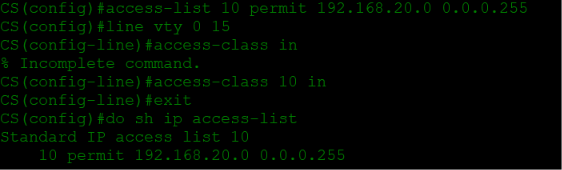
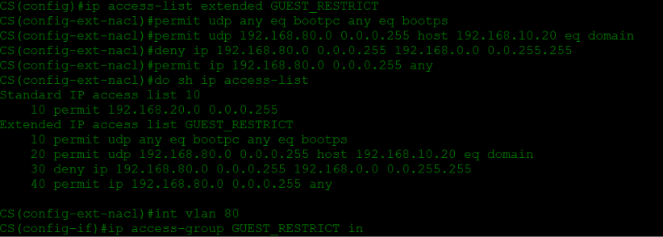
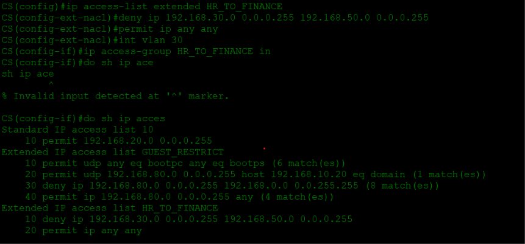
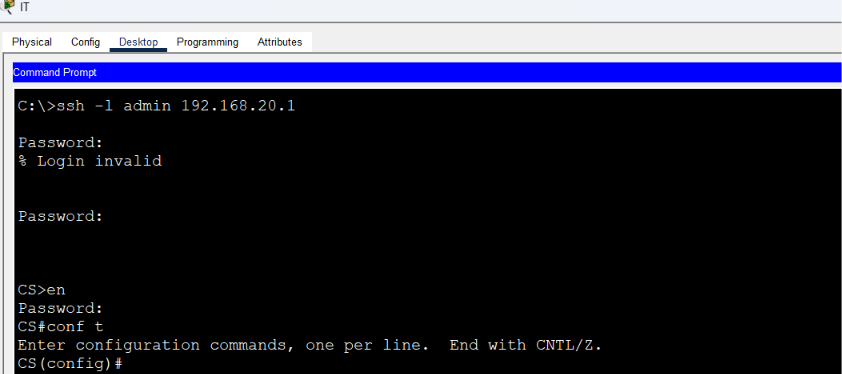
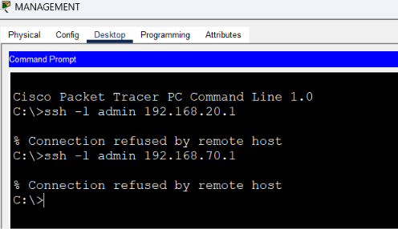
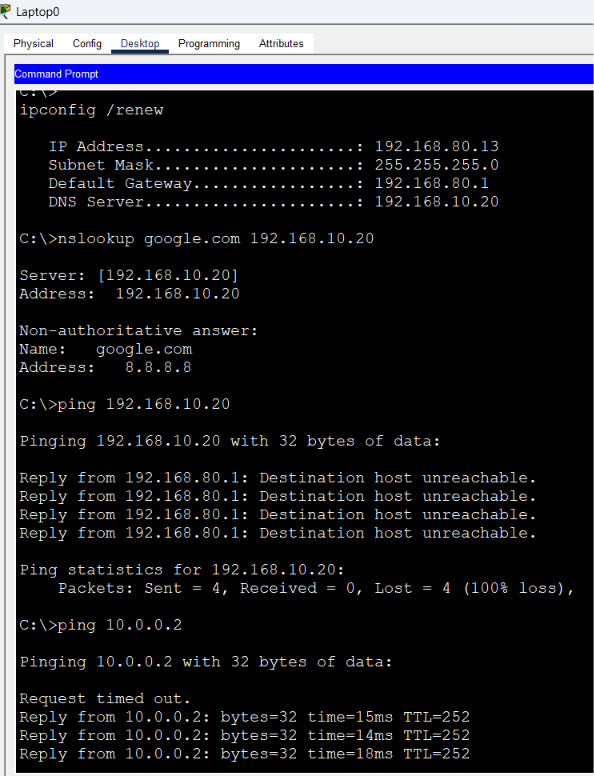
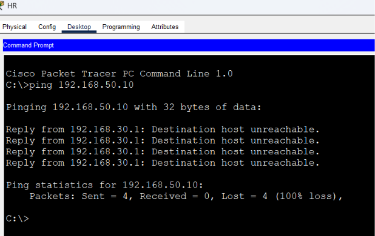

# ACL Security

## 1. Objective
The objective of this lab is to control network traffic between selected networks using access control lists (ACLs). ACLs filter traffic based on source, destination, protocol and service. In this lab, ACLs were used to:

- Restrict SSH management access to network devices.
- Restrict Guest (VLAN 80) access to internal networks.
- Restrict HR (VLAN 30) access to the Server network (VLAN 10).

## 2. Security Requirements

### Network Reference
| VLAN | Department | Network | Gateway |
|---|---|---|---|
| 10 | SERVER | 192.168.10.0/24 | 192.168.10.1 |
| 20 | IT | 192.168.20.0/24 | 192.168.20.1 |
| 30 | HR | 192.168.30.0/24 | 192.168.30.1 |
| 40 | ADMIN | 192.168.40.0/24 | 192.168.40.1 |
| 50 | FINANCE | 192.168.50.0/24 | 192.168.50.1 |
| 60 | SALES | 192.168.60.0/24 | 192.168.60.1 |
| 70 | MANAGEMENT | 192.168.70.0/24 | 192.168.70.1 |
| 80 | GUEST | 192.168.80.0/24 | 192.168.80.1 |

| Server | IP Address |
|---|---|
| WEB | 192.168.10.10 |
| DNS | 192.168.10.20 |
| DHCP | 192.168.10.30 |

### Security Rules Implemented
- **Device management (SSH):** Only the authorized network is allowed to manage network equipment over SSH. Other networks are blocked. *(TODO: state which VLAN(s) are permitted, e.g. IT VLAN 20, and which are denied.)*
- **Guest access:** The Guest network (VLAN 80) is restricted from reaching internal department networks. *(TODO: state exactly what Guest is still allowed to reach, e.g. internet only.)*
- **HR access to servers:** The HR network (VLAN 30) is restricted from accessing the Server network (VLAN 10). *(TODO: confirm which services, if any, are still allowed.)*

## 3. ACL Policy
| ACL name/number | Applied on device/interface | Direction | Purpose |
|---|---|---|---|
| [ACL-SSH name/number] | [Device / VTY lines] | In | Allow SSH management only from the authorized network and deny all other sources |
| [ACL-GUEST name/number] | [Device / VLAN 80 interface] | In | Restrict Guest users (192.168.80.0/24) from accessing internal networks |
| [ACL-HR name/number] | [Device / VLAN 30 interface] | In | Restrict HR users (192.168.30.0/24) from accessing the Server network (192.168.10.0/24) |

## 4. Configuration

### 4.1 SSH Management ACL
This ACL limits which networks can open SSH sessions to the device.

```cisco
! Insert the actual ACL commands used (see acl-ssh screenshot)
```



### 4.2 Guest ACL
This ACL controls traffic coming from the Guest network (192.168.80.0/24).

```cisco
! Insert the actual ACL commands used (see acl-guest screenshot)
```



### 4.3 HR ACL
This ACL controls traffic coming from the HR network (192.168.30.0/24) towards the Server network.

```cisco
! Insert the actual ACL commands used (see acl-hr screenshot)
```



## 5. Verification
The following commands were used to confirm that the ACLs exist and are applied to the correct interfaces or lines.

```cisco
show access-lists
show ip interface
```

- `show access-lists` displays each ACL, its rules and the number of packets that matched each rule.
- `show ip interface` shows which ACL is applied to an interface and in which direction.

## 6. Testing Results
Both permitted and denied traffic were tested.

| Test | Source | Destination | Expected Result | Actual Result |
|---|---|---|---|---|
| SSH from IT network | [IT PC, 192.168.20.x] | [Device IP] | [Permitted / Denied] | [Result, see acl-ssh-it-verify] |
| SSH from Management network | [Management PC, 192.168.70.x] | 192.168.20.1 | [Permitted / Denied] | Connection refused by remote host (see acl-ssh-management-verify) |
| Ping from Guest network | [Guest PC, 192.168.80.x] | [Internal host] | [Permitted / Denied] | [Result, see verify-acl-guest-1] |
| Ping from HR network | [HR PC, 192.168.30.x] | 192.168.10.10 (WEB) | Denied | Destination host unreachable, 100% packet loss (see verify-acl-hr) |

### Explanation
- **SSH test (IT):** [Describe whether the SSH session succeeded and why, based on the ACL.]
- **SSH test (Management):** The connection was refused, showing the SSH ACL blocks sources that are not authorized. *(Confirm this matches your intended policy.)*
- **Guest test:** [Describe the result and which ACL rule caused it.]
- **HR test:** The ping to the server received no replies, showing the HR ACL blocks HR traffic to the Server network.

## 7. Screenshots

### SSH ACL






### Guest ACL




### HR ACL



