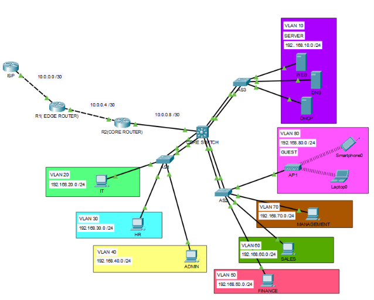

# Enterprise Network Design – Cisco Packet Tracer

## 1. Project Overview
This project demonstrates the design and configuration of a small enterprise network using Cisco Packet Tracer. The network separates departments using VLANs and provides routing, network services, and basic security.

## 2. Objectives
- Design an enterprise network topology.
- Configure IPv4 addressing and subnetting.
- Separate departments using VLANs.
- Configure inter-VLAN and dynamic/static routing.
- Provide DHCP and DNS services.
- Implement NAT/PAT and ACLs.
- Configure STP, EtherChannel, port security, and SSH.
- Test and troubleshoot end-to-end connectivity.

## 3. Network Topology

## 4. Devices Used
| Device | Model | Quantity |
|---|---|---:|
| Routers | Cisco 2911 | 3 |
| Layer 3 switch | Cisco 3560-24PS | 1 |
| Layer 2 switches | Cisco 2960 | 3 |
| PCs | PC-PT | 6 |
| Servers | Server-PT | 3 |
| Wireless access point | Packet Tracer AP | 1 |

## 5. Technologies Implemented
- IPv4 addressing and subnetting
- VLANs and trunking
- Inter-VLAN routing
- DHCP and DNS
- Static routing and OSPF
- NAT/PAT
- Standard and extended ACLs
- STP and EtherChannel
- Port security and SSH
- Connectivity testing and troubleshooting

## 6. Project Documentation
| Folder | Description |
|---|---|
| [01-Network-Topology](01-Network-Topology/) | Network layout and device roles |
| [02-IP-Addressing-Subnetting](02-IP-Addressing-Subnetting/) | IPv4 addressing plan |
| [03-VLAN-Configuration](03-VLAN-Configuration/) | VLAN creation and assignment |
| [04-Inter-VLAN-Routing](04-Inter-VLAN-Routing/) | Routing between VLANs |
| [05-DHCP-Configuration](05-DHCP-Configuration/) | DHCP pools and relay |
| [06-DNS-Server-Services](06-DNS-Server-Services/) | DNS and server services |
| [07-Static-Routing](07-Static-Routing/) | Static and default routes |
| [08-OSPF-Configuration](08-OSPF-Configuration/) | OSPF configuration |
| [09-NAT-PAT](09-NAT-PAT/) | Network address translation |
| [10-ACL-Security](10-ACL-Security/) | Access control lists |
| [11-STP-EtherChannel](11-STP-EtherChannel/) | Layer 2 redundancy |
| [12-Port-Security-SSH](12-Port-Security-SSH/) | Switch-port and remote-access security |

## 7. Project File
Open `Enterprise-Network.pkt` using Cisco Packet Tracer.

## 8. Screenshots
Configuration and verification screenshots are stored in the `Screenshots` folder.

---
